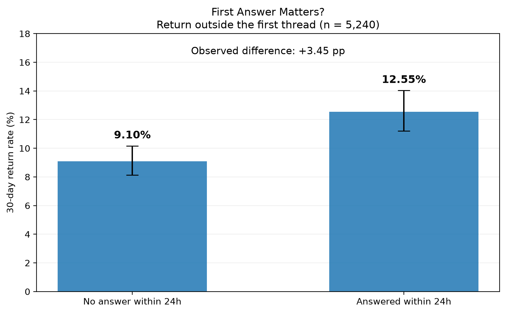
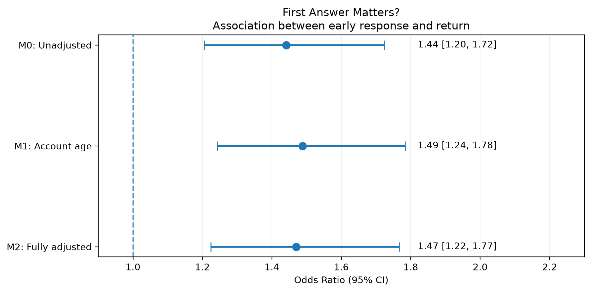
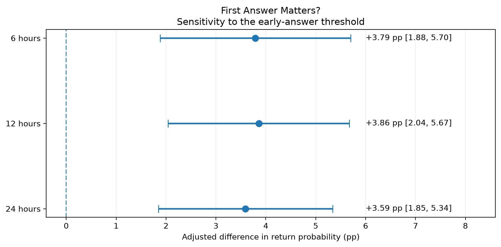

# First Answer Matters?
### Анализ возвращаемости пользователей Stack Exchange

Проект по продуктовой аналитике на данных [Cross Validated](https://stats.stackexchange.com/) — сообщества вопросов и ответов по статистике, машинному обучению и анализу данных.

**Цель исследования** — проверить, связана ли скорость получения первого ответа с последующей публичной активностью новых авторов.

**Гипотеза:** пользователи, получившие ответ на первый вопрос в течение 24 часов, чаще проявляют повторную активность за пределами первого обсуждения в следующие 30 дней.

## Данные и методология

**Источник:** [Stack Exchange Data Explorer](https://data.stackexchange.com/).

Когорта — **5 240 авторов Cross Validated, чей первый сохранившийся вопрос был опубликован в 2023 году**.

Основные переменные:

- **Answered within 24 hours** — наличие первого сохранившегося ответа другого пользователя в течение 24 часов после публикации вопроса.
- **Return within 30 days** — наличие публичной активности за пределами первого обсуждения спустя более 24 часов, но не позднее 30 дней после первого вопроса.

Учитываются новые вопросы, ответы и комментарии. Активность внутри первоначального обсуждения исключена из основной метрики.

Для проверки гипотезы использованы:

- двусторонний z-тест для сравнения долей;
- логистическая регрессия с учётом характеристик пользователя и первого вопроса;
- стандартизация предсказанных вероятностей;
- диагностика моделей и анализ чувствительности.

## Основные результаты

### Возвращаемость пользователей

Из 5 240 пользователей 2 119 (40,44%) получили ответ на первый вопрос в течение 24 часов.

| Показатель | Ответ за 24 часа | Нет ответа за 24 часа |
|---|---:|---:|
| Пользователей | 2 119 | 3 121 |
| Вернулись | 266 | 284 |
| Return Rate 30d | **12,55%** | **9,10%** |

**Наблюдаемая разница: +3,45 п. п.** (95% ДИ: [+1,74; +5,22], p = 0,000063).



### Логистическая регрессия

Построены три модели:

- **M0** — быстрый ответ без дополнительных признаков.
- **M1** — быстрый ответ и возраст аккаунта.
- **M2** — быстрый ответ, возраст аккаунта, характеристики и тематика вопроса, время публикации.

Все модели сравнивались на **единой выборке из 5 140 пользователей**. Исключены 100 наблюдений с аномальными датами регистрации.

| Показатель | M0 | M1 | M2 |
|---|---:|---:|---:|
| Odds Ratio | 1,4411 | 1,4886 | 1,4704 |
| 95% ДИ OR | [1,205; 1,724] | [1,242; 1,784] | [1,224; 1,766] |
| p-value | 0,000063 | 0,000017 | 0,000038 |
| AIC | 3438,47 | 3348,57 | 3371,24 |



В расширенной модели **M2 OR = 1,47**: при одинаковых значениях включённых признаков шансы возвращения у пользователей с быстрым ответом оцениваются примерно на 47% выше.

Скорректированные предсказанные вероятности составили:

- **12,63%** — при быстром ответе;
- **9,04%** — без быстрого ответа;
- **+3,59 п. п.** — скорректированная разница (95% ДИ: [+1,85; +5,34]).

Дополнительные признаки M2 не обеспечили статистически значимого совместного улучшения подгонки относительно M1 (LRT, p = 0,168). Модель M1 также имеет более низкий AIC. M2 использована для проверки устойчивости основной связи к дополнительной корректировке.

### Проверка устойчивости

Положительная связь сохранилась при изменении порога быстрого ответа:

| Порог | OR модели M2 | Скорректированная разница |
|---|---:|---:|
| 6 часов | 1,4858 | +3,79 п. п. |
| 12 часов | 1,5049 | +3,86 п. п. |
| 24 часа | 1,4704 | +3,59 п. п. |



Результат также сохранился при включении пользователей с аномальными датами регистрации.

## Выводы

Получение первого ответа в течение 24 часов устойчиво связано с более высокой вероятностью последующего публичного участия в сообществе.

Скорость первого ответа можно рассматривать как потенциально важную характеристику первоначального пользовательского опыта. Возможные продуктовые улучшения — маршрутизация первых вопросов, уведомления подходящих отвечающих и помощь в формулировке вопросов.

**Важно:** исследование основано на наблюдательных данных. Обнаруженная связь не доказывает причинное влияние скорости ответа на удержание пользователей. Для проверки причинного эффекта потребуется отдельное исследование, например A/B-тест.

## Технологии

- **SQL, PostgreSQL** — подготовка данных, аналитические витрины и проверки качества.
- **Python, pandas, NumPy** — обработка данных и подготовка признаков.
- **SciPy, statsmodels** — статистические тесты и логистическая регрессия.
- **Matplotlib** — визуализация результатов.

## Структура проекта

```text
stackexchange-first-answer-analytics/
│
├── sql/
│   ├── extraction/        # Выгрузка данных из SEDE
│   ├── setup/             # Схемы и таблицы PostgreSQL
│   ├── marts/             # Аналитические представления
│   └── checks/            # Проверки данных
│
├── src/
│   ├── hypothesis_testing.py
│   ├── robustness_check.py
│   ├── compare_logistic_models.py
│   ├── logistic_regression_m0_full_cohort.py
│   ├── logistic_regression_m1.py
│   └── visualize_results.py
│
├── reports/
│   ├── 01_h1_unadjusted.md
│   ├── 02_retention_analysis_2023.md
│   ├── 03_retention_regression_2023.md
│   └── figures/
│
├── data/raw/              # Локальные CSV, не включены в Git
├── requirements.txt
└── README.md
```

## Воспроизведение исследования

### 1. Подготовка окружения

Необходимы Python 3.13, PostgreSQL, Git и доступ к Stack Exchange Data Explorer. Команды рассчитаны на macOS/Linux.

```bash
git clone https://github.com/victoriia-warexify/stackexchange-first-answer-analytics.git
cd stackexchange-first-answer-analytics

python3 -m venv .venv
source .venv/bin/activate
pip install -r requirements.txt
```

### 2. Создание базы данных

```bash
createdb stackexchange_analytics

for file in sql/setup/*.sql; do
    psql -d stackexchange_analytics \
        -v ON_ERROR_STOP=1 -f "$file" || exit 1
done
```

Создаются схемы `raw`, `staging`, `analytics` и таблицы для исходных данных.

Python-скрипты используют локальную базу `stackexchange_analytics`. При необходимости параметры подключения можно задать через стандартные переменные окружения PostgreSQL.

### 3. Получение данных

Выполните запросы из `sql/extraction/` в [Stack Exchange Data Explorer](https://data.stackexchange.com/stats/query/new), выбрав сообщество Cross Validated.

Для анализа нужны следующие выгрузки:

| SQL-файл | Имя CSV |
|---|---|
| `06_first_question_users_2023.sql` | `first_questions_2023.csv` |
| `07_answers_to_2023_questions.sql` | `answers_to_2023_questions.csv` |
| `09_posts_activity_2023.sql` | `posts_activity_2023.csv` |
| `11_comments_activity_2023_h1.sql` | `comments_2023_h1.csv` |
| `12_comments_activity_2023_h2.sql` | `comments_2023_h2.csv` |
| `13_comments_activity_2024_jan.sql` | `comments_2024_jan.csv` |
| `14_user_registration_2023.sql` | `user_registration_2023.csv` |
| `15_initial_question_metadata_2023.sql` | `initial_question_metadata_2023.csv` |

Сохраните CSV с заголовками столбцов в `data/raw/`.

```bash
mkdir -p data/raw
```

### 4. Загрузка в PostgreSQL

Загрузите CSV в соответствующие таблицы схемы `raw`. Например:

```bash
psql -d stackexchange_analytics -v ON_ERROR_STOP=1 \
  -c "\copy raw.first_questions_2023 FROM 'data/raw/first_questions_2023.csv' WITH (FORMAT csv, HEADER true)"
```

Остальные файлы загружаются аналогично:

| Таблица PostgreSQL | CSV |
|---|---|
| `raw.answers_to_2023_questions` | `answers_to_2023_questions.csv` |
| `raw.posts_activity_2023` | `posts_activity_2023.csv` |
| `raw.comments_activity` | `comments_2023_h1.csv`, `comments_2023_h2.csv`, `comments_2024_jan.csv` |
| `raw.user_registration_2023` | `user_registration_2023.csv` |
| `raw.initial_question_metadata_2023` | `initial_question_metadata_2023.csv` |

При загрузке ответов пустые значения `answer_author_id` необходимо интерпретировать как `NULL`, например с помощью `FORCE_NULL (answer_author_id)` в команде `\copy`.

Загрузка предполагает пустые таблицы. Повторная загрузка без очистки приведёт к дублированию записей.

### 5. Построение витрин и проверка данных

Запустите SQL-файлы по порядку:

```bash
for file in sql/marts/*.sql; do
    psql -d stackexchange_analytics \
        -v ON_ERROR_STOP=1 -f "$file" || exit 1
done

for file in sql/checks/*.sql; do
    psql -d stackexchange_analytics \
        -v ON_ERROR_STOP=1 -f "$file" || exit 1
done
```

Файлы `sql/checks/` выводят диагностические результаты, которые необходимо проверить. Они не являются полноценными автоматическими тестами.

### 6. Запуск анализа

```bash
# Первоначальная гипотеза
python src/hypothesis_testing.py

# Проверка строгой метрики возвращаемости
python src/robustness_check.py

# Основное сравнение M0/M1/M2 (n = 5140)
python src/compare_logistic_models.py

# Дополнительная M0 на полной когорте (n = 5240)
python src/logistic_regression_m0_full_cohort.py

# Построение графиков
python src/visualize_results.py
```

Результаты полной M0 не используются в основной сравнительной таблице. Файл `logistic_regression_m1.py` сохранён для отдельного промежуточного анализа.

Графики сохраняются в `reports/figures/`. В текущей версии скрипта визуализации численные результаты заданы вручную, поэтому при повторном исследовании с новыми данными их нужно обновить.

**Примечание:** данные SEDE могут изменяться из-за удаления публикаций и обновлений выгрузки. Размеры выборок и результаты расчётов могут отличаться от опубликованных. Приведённые значения относятся к исходному исследованию.

## Подробные отчёты

1. [Первоначальная проверка гипотезы](reports/01_h1_unadjusted.md) — исходная метрика и сравнение долей.
2. [Анализ возвращаемости](reports/02_retention_analysis_2023.md) — уточнение метрики и структура активности.
3. [Регрессионный анализ](reports/03_retention_regression_2023.md) — модели, диагностика, проверки устойчивости и ограничения.

## Дальнейшее развитие

- Проверить результаты на когортах других лет.
- Исследовать возвращаемость за 7 дней и связь с закрытием первого вопроса.
- Автоматизировать выгрузку результатов моделей и создание графиков.
- Разработать дизайн A/B-теста для проверки продуктовой гипотезы.