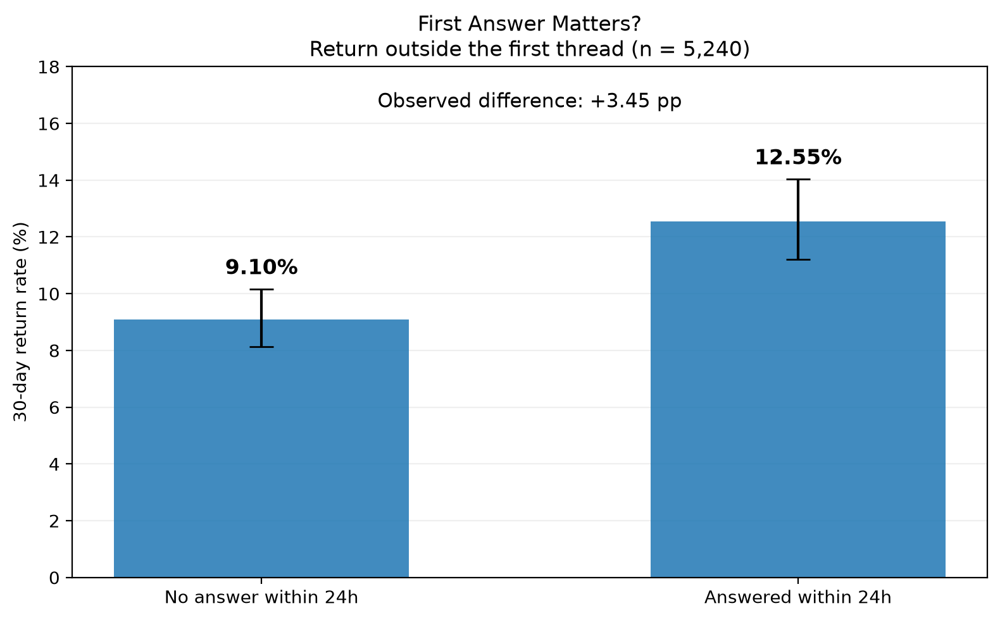
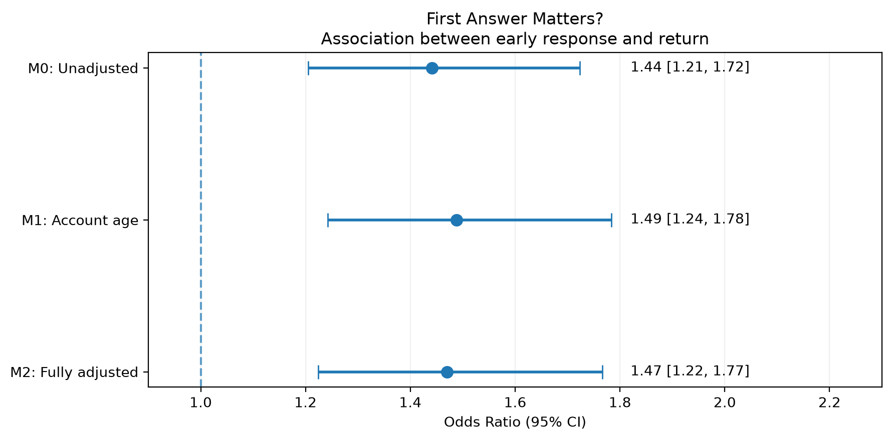
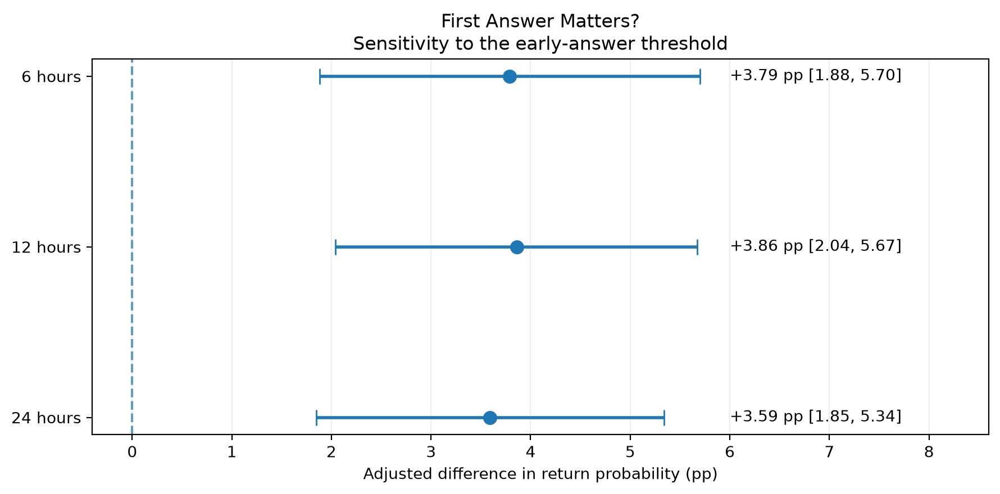

# First Answer Matters? — Анализ возвращаемости пользователей

## 1. Цель исследования

Цель исследования — проверить, связана ли скорость получения первого ответа с последующей активностью пользователей сообщества Cross Validated (Statistics Stack Exchange).

**Основная гипотеза:** пользователи, получившие ответ на первый вопрос в течение 24 часов, чаще возвращаются к участию в сообществе в течение следующих 30 дней.

Дополнительно проверяется, сохраняется ли эта связь после учёта возраста аккаунта, тематики и характеристик первого вопроса.

Исследование основано на наблюдательных данных и не позволяет установить причинно-следственную связь.

## 2. Данные и формирование когорты

Источник данных — Stack Exchange Data Explorer.

В исследование включены 5 240 пользователей, чей первый сохранившийся вопрос был опубликован в 2023 году.

Для анализа использовались:

- вопросы и ответы;
- комментарии пользователей;
- даты регистрации аккаунтов;
- первоначальные заголовки и теги вопросов;
- история публичной активности.

Единица наблюдения — пользователь. Каждый пользователь представлен одной строкой.

### Определение основных переменных

**Answered within 24 hours** — бинарный признак наличия первого сохранившегося ответа другого пользователя на исходный вопрос в течение 24 часов после его публикации.

**Return within 30 days** — бинарный признак повторной публичной активности пользователя за пределами первого обсуждения спустя более 24 часов, но не позднее 30 дней после публикации исходного вопроса.

Для основной метрики возвращаемости исключена активность внутри первого обсуждения: ответы на исходный вопрос и комментарии к нему или его ответам.

Таким образом, метрика отражает дальнейшее публичное участие в сообществе, а не продолжение первоначального обсуждения.

## 3. Описательный анализ основной метрики

Среди 5 240 пользователей:

- 2 119 (40,44%) получили ответ за первые 24 часа;
- 3 121 (59,56%) не получили ответ за этот период;
- 550 (10,50%) проявили повторную активность за пределами первого обсуждения.

| Группа | Пользователей | Вернулись | Return Rate |
|---|---:|---:|---:|
| Ответ за 24 часа | 2 119 | 266 | 12,55% |
| Нет ответа за 24 часа | 3 121 | 284 | 9,10% |

*Рисунок 1. Возвращаемость пользователей в течение 30 дней
за пределами первого обсуждения. Вертикальные линии —
95% доверительные интервалы Уилсона для долей.*

**Наблюдаемая разница возвращаемости: +3,45 процентного пункта.**

Для сравнения двух долей использован z-критерий. Различие статистически значимо: p ≈ 0,000063, 95% доверительный интервал разницы составляет [+1,74; +5,22] п. п.

## 4. Логистическая регрессия

Для оценки связи между быстрым ответом и возвращаемостью построены три логистические регрессии.

- **M0:** только получение ответа за 24 часа.
- **M1:** быстрый ответ и возраст аккаунта.
- **M2:** быстрый ответ, возраст аккаунта, характеристики первого вопроса, время публикации и девять распространённых тегов.

В M1 и M2 возраст аккаунта представлен категориальными признаками.

Основные модели оценивались на одинаковой выборке из 5 140 пользователей. Из неё исключены 100 наблюдений, у которых дата регистрации аккаунта позже даты первого вопроса.

### 4.1. Результаты моделей

| Показатель | M0 | M1 | M2 |
|---|---:|---:|---:|
| Odds Ratio быстрого ответа | 1,4411 | 1,4886 | 1,4704 |
| Нижняя граница 95% ДИ | 1,2050 | 1,2421 | 1,2239 |
| Верхняя граница 95% ДИ | 1,7236 | 1,7840 | 1,7664 |
| p-value | 0,000063 | 0,000017 | 0,000038 |
| Pseudo R² Макфаддена | 0,00461 | 0,03241 | 0,04322 |
| AIC | 3438,47 | 3348,57 | 3371,24 |

*Рисунок 2. Отношение шансов возвращения при получении
первого ответа за 24 часа. Точки — OR, горизонтальные линии —
95% доверительные интервалы. Вертикальный пунктир — OR = 1.
Все модели построены на 5 140 пользователях.*

Во всех трёх моделях отношение шансов превышает единицу, а 95% доверительные интервалы не включают единицу.

В расширенной модели M2 **OR = 1,4704**. Это означает, что при одинаковых значениях включённых признаков шансы возвращения у пользователей с быстрым первым ответом оцениваются примерно на 47% выше.

Данный показатель характеризует отношение шансов, а не относительное изменение вероятности.

### 4.2. Скорректированные вероятности

Для интерпретации результатов в продуктовых метриках использована стандартизация предсказанных вероятностей.

Для каждого пользователя рассчитаны два прогноза — при наличии и отсутствии ответа за первые 24 часа — с сохранением остальных характеристик. Затем полученные вероятности усреднялись.

| Показатель | M1 | M2 |
|---|---:|---:|
| Без быстрого ответа | 8,99% | 9,04% |
| С быстрым ответом | 12,74% | 12,63% |
| Скорректированная разница | +3,74 п. п. | +3,59 п. п. |
| 95% ДИ разницы | [+2,00; +5,49] | [+1,85; +5,34] |

Скорректированные вероятности рассчитаны методом стандартизации предсказаний по эмпирическому распределению признаков. Стандартная ошибка разницы оценена методом дельта на основе ковариационной матрицы коэффициентов логистической регрессии. Для построения 95% доверительного интервала использовано нормальное приближение.

В M2 скорректированная разница предсказанных вероятностей составляет **+3,59 п. п.**

Результат свидетельствует о положительной статистической связи после учёта выбранных характеристик, но не представляет собой оценку доказанного причинного эффекта.

## 5. Диагностика и сравнение моделей

Все три модели успешно сошлись.

Матрица признаков M2 имеет полный ранг: 35 из 35.

Проверка мультиколлинеарности с помощью VIF показала:

- максимальный VIF — 1,92;
- VIF для `answered_24h` — 1,0205;
- признаков с VIF выше 5 нет.

Существенной мультиколлинеарности по данному диагностическому критерию не обнаружено.

### Сравнение M1 и M2

Для вложенных моделей использован тест отношения правдоподобий:

- LR statistic = 37,3267;
- степени свободы = 30;
- p-value = 0,167812.

Дополнительные признаки M2 не обеспечили статистически значимого совместного улучшения подгонки относительно M1 при уровне значимости 0,05.

При этом AIC у M1 ниже, чем у M2 (3348,57 против 3371,24), что также свидетельствует в пользу более компактной модели по данному критерию.

Расширенная M2 использована для проверки устойчивости основной связи к дополнительной корректировке.

## 6. Проверки устойчивости

### 6.1. Аномальные даты регистрации

У 100 пользователей (1,91% когорты) дата регистрации позже даты первого вопроса.

Для проверки устойчивости эти наблюдения были возвращены в выборку с отдельной категорией возраста аккаунта.

| Модель | Без аномальных дат, OR | С аномальными датами, OR |
|---|---:|---:|
| M1 | 1,4886 | 1,4800 |
| M2 | 1,4704 | 1,4622 |

Оценки практически не изменились. Основная связь устойчива к рассмотренным вариантам обработки аномальных дат.

### 6.2. Альтернативные пороги первого ответа

Дополнительно проведён анализ для порогов 6, 12 и 24 часа.

Для всех порогов построена M2 на одинаковой выборке из 5 140 пользователей.

| Порог | Odds Ratio | 95% ДИ OR | Скорректированная разница |
|---|---:|---|---:|
| 6 часов | 1,4858 | [1,2287; 1,7967] | +3,79 п. п. |
| 12 часов | 1,5049 | [1,2499; 1,8118] | +3,86 п. п. |
| 24 часа | 1,4704 | [1,2239; 1,7664] | +3,59 п. п. |

*Рисунок 3. Скорректированная разница предсказанных
вероятностей возвращения при порогах ответа 6, 12 и 24 часа.
Горизонтальные линии — 95% доверительные интервалы.
Оценки получены на одной выборке из 5 140 пользователей.*

Положительная связь сохраняется при всех трёх определениях быстрого ответа.

Различия между оценками для самих порогов отдельно не проверялись, поэтому результаты не позволяют выбрать оптимальную скорость ответа.

Дополнительные проверки носят исследовательский характер.

## 7. Ограничения исследования

Исследование имеет несколько ограничений.

1. **Наблюдательный характер данных.** Получение быстрого ответа не распределялось случайным образом. Сохраняется возможность влияния неучтённых факторов.

2. **Сложность и качество первого вопроса.** Использованы длина заголовка и первоначальные теги, однако они не полностью отражают сложность, понятность и качество формулировки вопроса.

3. **Ограниченность измерения активности.** Учитывались публичные публикации и комментарии. Просмотры сайта и другие непубличные действия недоступны.

4. **Особенности исторических данных.** Удалённые публикации и изменения аккаунтов могут влиять на восстановление первого вопроса и пользовательской активности.

5. **Одна годовая когорта.** Основной регрессионный анализ проведён на пользователях, впервые задавших сохранившийся вопрос в 2023 году. Переносимость результатов на другие периоды не проверена.

6. **Дополнительный исследовательский анализ.** Часть метрик и проверок устойчивости была сформирована после первоначального анализа, поэтому результаты не следует интерпретировать как полностью заранее зарегистрированное подтверждающее исследование.

7. **Спецификация модели.** Для длины заголовка и количества тегов использована линейная связь с логитом. Отдельная проверка адекватности этой функциональной формы не проводилась. Низкие значения VIF и успешная сходимость не исключают ошибок спецификации модели.

8. **Независимость наблюдений.** Каждый пользователь представлен одной строкой, однако взаимодействия участников сообщества могут создавать зависимости между наблюдениями. Стандартные ошибки моделей рассчитаны без специальной корректировки на такие зависимости.

## 8. Продуктовые выводы

Получение первого ответа в течение 24 часов устойчиво связано с более высокой вероятностью дальнейшего публичного участия в сообществе.

Эта связь сохраняется после учёта возраста аккаунта, времени публикации, тематики и характеристик первого вопроса, а также при альтернативных порогах быстрого ответа.

Результаты позволяют рассматривать скорость первого ответа как потенциально важную характеристику первоначального пользовательского опыта.

В качестве дальнейшего продуктового исследования можно проверить механизмы, которые помогают новым авторам быстрее получать содержательные ответы: улучшение маршрутизации вопросов, уведомления подходящим отвечающим и помощь в формулировке вопроса.

При этом внедрение таких механизмов должно сопровождаться оценкой не только скорости ответа, но и его качества, удовлетворённости пользователей и повторной активности.

Для установления причинного эффекта потребуется отдельное исследование с более сильным дизайном, например рандомизированный эксперимент.

## 9. Заключение

В анализируемой когорте из 5 240 авторов первых сохранившихся вопросов Cross Validated получение ответа в течение 24 часов связано с более высокой вероятностью последующей публичной активности за пределами первоначального обсуждения.

В расширенной логистической модели отношение шансов составило **1,47** (95% ДИ: 1,22–1,77), а скорректированная разница предсказанных вероятностей — **+3,59 процентного пункта** (95% ДИ: +1,85–5,34 п. п.).

Результат оказался устойчивым к включению пользователей с аномальными датами регистрации и изменению порога быстрого ответа с 24 до 12 и 6 часов.

Полученные результаты подтверждают наличие статистической ассоциации, но не доказывают причинное влияние скорости ответа на удержание пользователей.